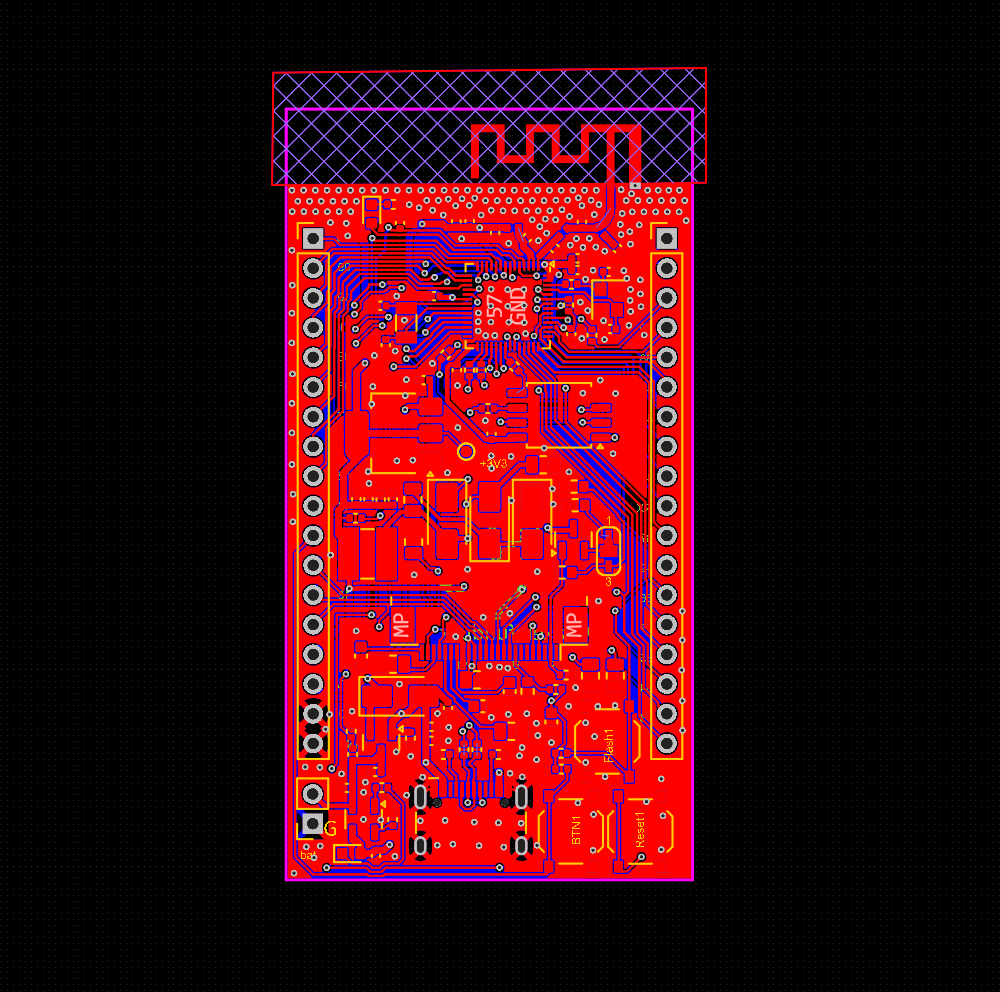
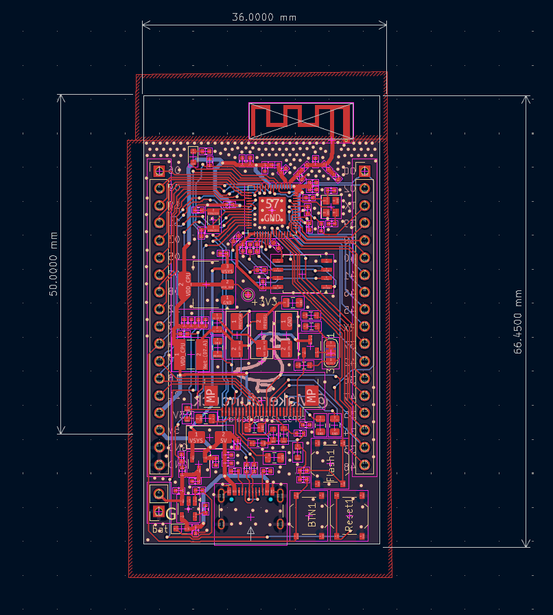

# rebuild_in_jlceda

把 KiCad 的 `.kicad_pcb` 转成嘉立创EDA 专业版里**能继续编辑的 PCB 工程**。
转换后自动跑规则、重铺覆铜、跑 DRC、导出 Gerber，并和 KiCad 出图做统计对照。

- **适合**：已有 KiCad 板，想搬到嘉立创EDA 继续改或下单。
- **不适合**：需要迁移原理图 / BOM / CPL，或希望"点一下就得到可投板文件"。

> **开发预览版 · 0.4.0**。结果需要人工复核，不提供可制造性保证。
> 完整流程会在你当前登录的 EDA 账号里**新建工程**，并设置该工程的规则、文字和覆铜。
>
> 本项目代码由 **AI 生成**（不含人类手写代码），人工只负责需求、评审与验收。
> 个人实验项目，维护时间有限；**实际使用前建议先 fork 后自行修改**。

## 最短路径

三步跑起来（细节见 [安装](#安装)）：

1. 在 [Releases](https://github.com/ngHackerX86/rebuild_in_jlceda/releases)
   下载 `rebuild_in_jlc-0.4.0.zip`，解压到固定目录。
2. 进入**含 `install.ps1` 的那一层**，打开 PowerShell：

   ```powershell
   powershell -NoProfile -ExecutionPolicy Bypass -File .\install.ps1
   ```

3. 回到 KiCad PCB 编辑器：**工具 → 外部插件 → 刷新插件**。

菜单里出现 **重建到嘉立创EDA（KiCad→JLCEDA）** 就装好了。

> 解压目录**不要删**。插件运行时要读里面的 `tools/` 和模板。

## 它做什么

| 做 | 不做 |
|---|---|
| `.kicad_pcb` → `.eprj3`（可编辑工程） | 原理图、BOM、CPL 迁移 |
| 导入 EDA 账号工作区并打开 PCB | 制造放行判定 |
| 补写反相（挖空）文字 | 几何等价证明 |
| 对齐间距规则预设 | 盲埋孔、复杂焊盘栈 |
| 自动重铺覆铜（失败回退人工） | |
| DRC、Gerber 导出、逐层统计对照 | |

工程能力边界写得比较细，见 [支持范围与限制](docs/支持范围与限制.md)。

## 目前的转换效果

以 Ducky 板（98 器件 / 2 层）为例，同一次转换的前后对照：

| 转换后在嘉立创EDA 里 | KiCad 原设计 |
|---|---|
|  |  |
| 走线、过孔、焊盘、丝印、板框都已重建，可在 EDA 里继续编辑 | 右侧为源板（含 KiCad 的尺寸标注，标注本身不参与转换）|

看这张图时请注意三点：

1. **颜色是各自的显示配置**，不是差异；EDA 里可以改配色。
2. **丝印线型会变**：KiCad 的虚线在 EDA 里会变成实线（EDA 丝印不支持线型设置）。
3. **铺铜形状会有出入**：两边重铺算法不同，同一条网络的高亮范围可能不完全一样。

更多已知差异见 [支持范围与限制](docs/支持范围与限制.md) 第 6 节。

## 环境要求

| 项 | 要求 |
|---|---|
| 系统 | Windows 10/11（Linux、macOS 的完整流程**未验证**）|
| KiCad | 10.0.8；需要自带 Python（`import pcbnew`）|
| 嘉立创EDA | 专业版 4.1.100；已安装、已登录 |
| Python | 3.10+，用于调度（转换本身用 KiCad 的 Python）|

触发一次完整流程前，请先**保存源 PCB**，并确认 EDA 里当前登录的是哪个账号。

## 安装

### 方式一：发布包（推荐）

按上面 [最短路径](#最短路径) 的两步解压、执行安装脚本即可。

GitHub 页面上还有一个 `Source code (zip)`，那是**源码归档**，里面没有生成好的
`install.ps1`，要走方式二。

### 方式二：源码手工安装

1. 克隆或下载本仓库，放到固定目录。
2. KiCad 里选 **工具 → 外部插件 → 打开插件目录**，记下路径。
3. 把 `rebuild_in_jlc/` 复制进去（需要 Gerber 工具再加 `kicad_jlc_exporter/`）。
4. 刷新插件，首次运行时把 `repo_root` 指向仓库根目录。

插件目录只负责被 KiCad 加载；`tools/` 和模板留在源码目录里，由 `repo_root` 指过去。

### 配置

首次点菜单若提示配置缺失，会弹设置框；也可以改 `%APPDATA%\rebuild_in_jlc\config.json`。
最容易填错的是 `repo_root`：它要指向**源码根或解压目录**，不是插件目录。

五个字段逐项说明见 [首次配置](docs/使用指南.md#首次配置)。

## 跑一次

1. 在 KiCad 保存 PCB（插件读磁盘文件，没保存的修改不会进去）。
2. 打开 EDA、登录、确认账号。
3. 点 **重建到嘉立创EDA**。
4. 若弹出"请手工重建覆铜"，在 EDA 里执行 **设计 → 重建覆铜**，
   再回到**同一个窗口**点继续。不要重跑整条命令来接续。
5. 在结果窗口点 **打开工作目录**，看 DRC、`layer_compare.md` 和导出物。

输出默认在板文件旁的 `out/rebuild_in_jlc_<时间戳>/`：

| 路径 | 内容 |
|---|---|
| `build/` | 生成的可编辑工程 |
| `gerber/Gerber.zip` | 导出的制造文件 |
| `layer_compare.md` | 与 KiCad 的逐层统计对照 |
| `run.json`、`step_*.log` | 每步状态与完整日志 |

**三种结果别混**：步骤完成 ≠ 验证通过 ≠ 可以制造。
`compared` 只表示图元计数在容差内一致；看到 `differs`、`missing_evidence`
要回去查差异，而不是当作通过。详见 [使用指南](docs/使用指南.md#结果怎么判断)。

## 常见卡点

| 现象 | 先查 |
|---|---|
| 菜单里没有插件 | 插件目录里应直接看到 `rebuild_in_jlc/` 下的 `__init__.py`，然后刷新或重启 |
| 报"找不到 tools / 仓库根不对" | `repo_root` 是否指向解压目录或源码根 |
| 报找不到 `pcbnew` | `kicad_python` 是否指向 KiCad 的 `bin/python.exe` |
| 报没有 EDA 会话 | EDA 是否已启动、登录、并打开过工程 |

更多排错见 [安装与常见问题](docs/使用指南.md#常见问题)。

## 已知问题

- 自动覆铜"完成"的判定不够严：只要有一块灌上就报成功，重铺后请目视确认。
- GUI 后半程不写 `run.json`，与 CLI 状态不一致。
- `--dry-run` 目前**不能当只读**，它仍会重铺并保存。
- 六层及以上板子的内层对照还不完整；板级丝印图形不进 3D 预览。
- 多行底层文字的排版、字体（会被映射成 Arial）与 KiCad 有差异。
- 嘉立创EDA 的丝印线条**不支持设置线型**，所以 KiCad 里的虚线转换后会变成实线。

完整清单见 [支持范围与限制](docs/支持范围与限制.md) 第 6 节。

## 我要……

| 想做的事 | 看这里 |
|---|---|
| 装插件、改配置、排错 | [使用指南](docs/使用指南.md) |
| 命令行分步跑、看参数 | [使用指南 · 命令行调试](docs/使用指南.md#命令行调试) |
| 只检查/打包已有 Gerber | [Gerber 工具](kicad_jlc_exporter/README.md) |
| 看哪些板子验证过、数字多少 | [验证记录](docs/验证记录.md) |
| 自己造测试板、跑回归 | [开发与测试](docs/开发与测试.md) |
| 知道哪里会坏、哪些不支持 | [支持范围与限制](docs/支持范围与限制.md) |
| 看这版改了什么 | [CHANGELOG](CHANGELOG.md) |

## 反馈与许可

提 Issue 请带上：版本、失败步骤、脱敏报错、可公开的最小复现板。
日志里可能有本机路径和账号工程名，分享前自己检查一遍。
也可以直接用 [Bug 模板](.github/ISSUE_TEMPLATE/bug_report.yml)。

> 作者很懒，Issue 处理可能很慢。推荐先 fork 自己用 AI 改一版，往往比等回复快。

代码以 [MIT](LICENSE) 发布；模板与第三方素材的来源、许可见
[THIRD_PARTY_NOTICES](THIRD_PARTY_NOTICES.md)。
样例验证用过 [esp32-s3-devkit](https://github.com/HeyPCB/esp32-s3-devkit) 与
[esp32s3-plant-monitor](https://github.com/MuffinByteLabs/esp32s3-plant-monitor)，
各自沿用原许可。
